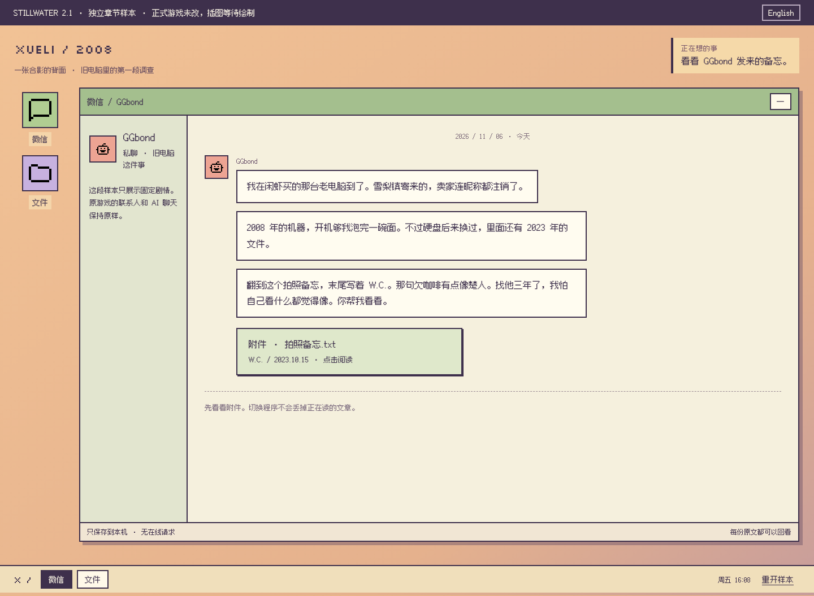
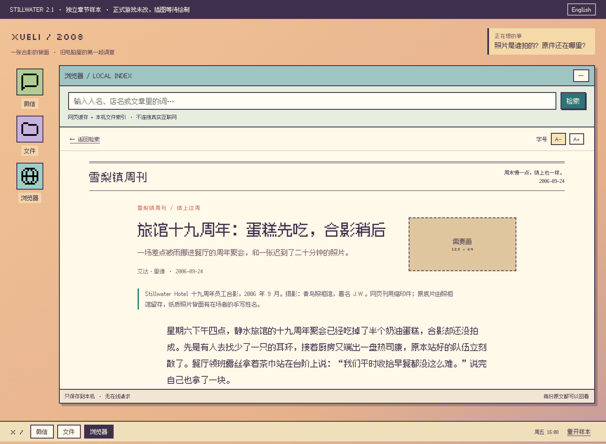
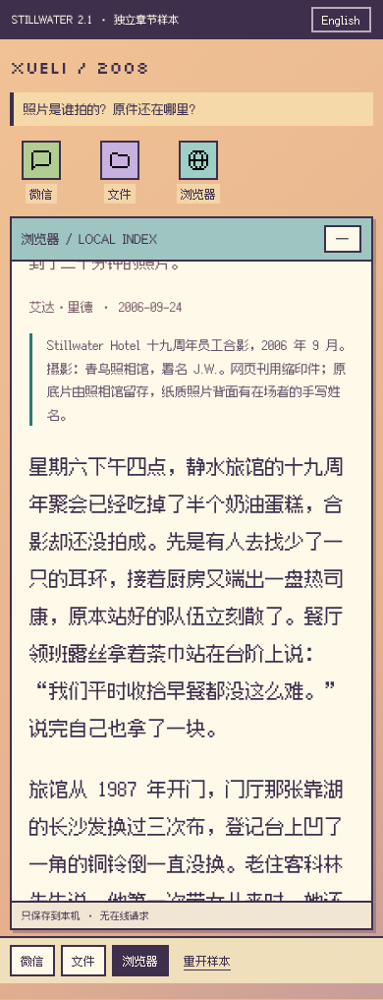

# Stillwater 2.1：一张合影的背面

> 视觉上有点鲜艳、可爱、甚至好笑；玩法上像在翻别人留下的旧电脑；故事则从有趣的调查，慢慢走向一种令人绝望的真相。

当前文章仍是临时稿，等待用户交回 ChatGPT 的新正文。[逐张美术任务](handoff/ART-BRIEF.zh-CN.md)、[完整文案任务单](handoff/WRITING-BRIEF.zh-CN.md)与[回稿后的试玩计划](handoff/PLAYTEST-PLAN.zh-CN.md)已整理。

[现成素材与剩余待绘清单](reuse/REUSE-AUDIT.zh-CN.md) · [实际素材预览](reuse/index.html)。四个程序图标与 GGbond 头像已用同套 MIT 像素素材，关键照片仍留框。

这是一个能从头玩到新剧情的独立调查样本，不是正式游戏更新。停在第一条完整推理之后，等确认阅读与调查体验，再决定后面怎么做。

[打开独立试玩](https://raw.githack.com/RieyekiWong/123/design/xueli-21-chapter-01/design-previews/xueli-21-chapter-01/index.html)。第一次访问托管站可能先显示 External Content Notice，点击 **Open the page** 才会进入样本。

[完整中文正文](CHAPTER-TEXT.zh-CN.md) · [English reading copy](CHAPTER-TEXT.en.md) · [待绘清单](TO-DRAW.md) · [设计、参考与验证规则（含答案）](DESIGN.zh-CN.md)

## 先看页面







## 这一小章怎么玩

从 GGbond 的附件开始。楚人留下的备忘有一个书签，指向旅馆周年报道。照片说明里有可以继续追查的词，玩家自行输入检索框。新资料把一家店、一个人和一封本机邮件联系起来，最后在笔记里亲自填写信息即可，不需要勾选或引用原文。

第一次只确认楚人的约见计划，不把它当成实际到访。核对成功后直接切回 GGbond 的固定消息，新附件带出下一章的疑问。不会让玩家在页面底部找继续按钮。

开场只露出微信、文件两个入口。读过备忘才出现浏览器，查到后续资料才出现调查笔记。已读资料可以重开，文章位置、搜索词、笔记草稿和提示级别各自保存。中途去看无关文章也不会丢进度。

这里不接在线 AI，也没有仿装成 AI 的输入框；GGbond 的几条固定消息只用来演示剧情衔接。正式游戏原有微信 UI、群聊、私人聊天、AI / Cloudflare、通知和返回浏览器机制均未修改。B-3、正式网站、广告、结局和原存档也没有改。

## 阅读与美术

杏色桌面、青绿色浏览器、淡绿色通讯器和浅金色笔记共用深紫描边、方角、同一套字号与间距。软件有自己的颜色，但不换一套窗口规则。没有生成新图像；通用程序和 GG 头像采用现成像素图形，未完成的场景与人物画框继续写“需要画”，照片可用 128×64 横图、64×128 竖图等 64 像素格组合，不再限定方形。

中文正文继续用已有、已附授权的 Fusion Pixel；英文像素标题用 Silkscreen。英文长文章用系统衬线字体，避免整页装饰性像素英文。正文可调为 18、20、22、24 px；不把长文塞进多栏小格。

本章有八份可读资料。周年报道、摄影师专访、镇民来信、楚人日记都有完整段落；目录和邮件按它们本来应有的长度写。不是每篇都藏着谜题，普通日记和长椅来信不会替玩家填答案。具体字数见 [content-counts.json](content-counts.json)。

## 验证与边界

运行本地预览（从仓库根目录）：

```sh
python3 -m http.server 3135 --bind 127.0.0.1 --directory design-previews
```

打开 `http://127.0.0.1:3135/xueli-21-chapter-01/`。

```sh
node design-previews/xueli-21-chapter-01/chapter.test.mjs
node design-previews/xueli-21-chapter-01/browser-check.mjs
```

模型测试检查发现顺序、检索边界、中文英文填写、不同资料发现顺序、错误反馈、恢复与篇幅。浏览器测试实际完成两种语言的流程，覆盖 1440 px 桌面、390 px 手机和 320 px 窄屏，并验证没有调用任何 API。实际结果保存在 [browser-checks.json](browser-checks.json)。

最终结果：18 项样本模型测试通过；四次浏览器完整流程通过，另通过损坏存档、禁止存储和安全文字显示检查。现有游戏构建、156 项回归测试与两项 `v2` 浏览器回归也通过；AI 上游使用测试替身。正式游戏文件均未改变，当前修复仅涉及独立样本与交接文档，记录见 [verification.json](verification.json)。

本样本使用独立键 `stillwater-xueli-sample:v1`，不读取正式游戏的 `stillwater-case:v2` 或 `stillwater-chat:v1`。重开需要确认，并且只清除此样本。损坏的样本存档保留原内容，不静默覆盖。

后面的位体教、NULL 改写、完整窗口管理器、真实 AI 接入新桌面和重新嵌入 B-3 都没有在这次样本中制作；本次也没有声称已试玩新的完整游戏。
