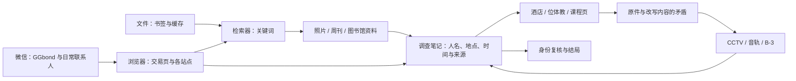

# 雪梨镇 2.1 · 画面与流程粗样

依据用户上传的《Stillwater 2.1 / 雪梨镇像素重制版》制作。**用户本轮要求的是大致浏览各阶段与流程，因此这里只做概念样机，没有启动完整重制。** 附件中的 P0–P8 开发清单不等于本轮已经获准全部实施。

之前暂停的位体教现代首页草图保持原样，没有接着改，也没有把它推广到其他栏目。

## 怎么看

- `index.html`：可切换的粗样，分“按章节／按程序／按网站”。
- `index.html?view=all`：八幕同时浏览。
- `index.html?view=all&part=early` / `part=late`：前四幕／后四幕。
- `index.html?stage=5`：直接看第六幕；参数从 0 开始。
- `overview-early.png`、`overview-late.png`：两张实际浏览器渲染的总览图。
- `screens/stage-01.png` 至 `stage-08.png`：每一幕的完整大图。
- [待绘清单](TO-DRAW.md)：64 × 64 素材及替换位置。

本地查看可用：

```sh
python3 -m http.server 3130 --bind 127.0.0.1 --directory design-previews/xueli-21-overview
```

打开 `http://127.0.0.1:3130/`。不需要开游戏、不需要 API Key。

## 大致流程

**GGbond 买到旧电脑 → 本地资料与交易页 → 论坛／周刊／图书馆 → 酒店历史站 → 位体教与楚人课程 → 发现改写 → CCTV／音轨／B-3 → 重新核实身份 → 结局。**

| 幕 | 主要画面 | 玩家要弄清的问题 | 下一幕从哪里来 |
|---|---|---|---|
| 1 旧电脑启动 | 像素通讯器、闲虾交易页、书签与文件夹 | 楚人最后在查什么？ | 第一条能附来源的调查记录 |
| 2 资料追踪 | 检索器、雪梨镇论坛、周刊、图书馆 | 哪些人名和地点互相关联？ | 第一组经过核对的关系与酒店来源 |
| 3 酒店历史站 | 员工、合影、活动与留言 | Nora 是谁，记录为什么矛盾？ | 指向位体教的活动和档案来源 |
| 4 位体教 | 像素组织官网、公开研究、课程项目页 | 酒店、位体教与楚人有何关系？ | 保留原件后，发现一处具体改写 |
| 5 资料被改写 | 照片对照、周刊与网页差异、笔记补全 | 哪份是原件，哪份是后写的？ | 重建输出的来源与声像工具 |
| 6 信号分离 | CCTV、音轨、B-3 | 能保住哪一段独立来源？ | 恢复的原声、画面与日期 |
| 7 身份对抗 | 调查笔记、旧材料、新账号会话 | 它像楚人，但哪些证据支持身份？ | 关键来源复核后进行最终处理 |
| 8 结局 | 安静的结果窗口、保留下来的原件 | 定位到线索、保留未知，还是替代完成？ | 明确 GAME OVER，不依赖大鬼脸 |

这不是正式谜题答案表。人名关系、具体证据、各结局规则仍需下一步确认；不会用“看完文件”代替实际推理。最终推进方向已列出，但尚未接入真实自动跳转。

2008 年指主机型号年代，**不是**所有资料的日期。界面在图外区分 2006 旧快照、2023 留存和 2026 恢复输出。新地名按本稿统一为雪梨镇，不混用旧方案的地名。

## 程序与资料的关系



### 调查笔记的字段草案

人物、地点、时间、组织归属、最后联系人、事件顺序、引用来源、原件日期、改写疑点、核实状态。状态暂用“待填写／待核对／来源冲突／来源保留”，系统自动填写另列标记。普通聊天不自动成为所有人的共同记忆。

### 第一批资料草案

闲虾交易记录与卖家缓存、旧电脑书签、课程材料目录、论坛生活主题和维修主题、周刊活动报道与普通广告、图书馆旧湖区地图及索引、酒店合影与员工记录、位体教公开项目与楚人的 2023 课程页。多数内容不必是谜题。

## 保留与隔离

| 部分 | 这次的状态 | 将来重制时的方向 |
|---|---|---|
| `chat-model.js`、`chat-transport.js`、人物数据与 Worker | 完全未修改、未加载到粗样 | 保留聊天、同意机制、记忆与备用，只替换外壳 |
| `chat-view.js`、通知与返回浏览器 | 完全未修改 | 继续保持独立联系人和原网页返回 |
| `case-night-model.js`、`case-night.js` | 完全未修改 | 复用 A–F、90° 旋转、隔离与保存的操作核心 |
| 旧首页、档案关卡与样式 | 不删除、不覆盖 | 后续用独立版本边界隔离，不继续堆在旧首页上 |
| 原 case/chat 与 2.0 进度 | 不读取、不改写 | 正式重制前另做明确迁移方案 |
| 原搞笑广告及广告收藏 | 不删、不替换 | 新地方广告与原内容并存，仅平静时段投放 |

样机里的标题栏、最小化/关闭符号、检索、设置、接线、发送按钮只是画面示意，**不是已经完成的窗口管理器或玩法**。实际能操作的是预览选择、章节浏览、站点浏览和三种结局方向切换。

## 美术与字体

所有主要图像都是方形“需要画”占位；没有生成人物、背景、广告图或鬼脸。接头边线、波形条和窗口边框是界面结构，不是替用户画的主要素材。

中文使用官方 **Fusion Pixel 12px 简体中文**；英文标题使用 **Silkscreen**。均为现成开源字体，不生成汉字，已保留字体与复合字体来源的 OFL 许可。来源与哈希在 `assets/font-sources.json`。长中文不用英文装饰字体。

## 模块参考与边界

只采用 Windows 2000 风格的共同窗口语法。各内容页借鉴的是资料组织方式，不把四个网站的配色拼进一个窗口。下列为本次快速浏览公开说明的参考，不代表完整试玩了这些作品。

| 模块 | 布局／内容来源 | 字体与共同配色 | 交互或氛围参考 |
|---|---|---|---|
| 旧电脑桌面 | [Windows 2000 实例][desktop] | [Fusion Pixel][font]，共用灰蓝窗口 | [98.css 控件说明][controls]、[Hypnospace][hyp] |
| 微信通讯器 | [微信官方 Mac 商店页][wechat]，保留已有联系人布局 | [Fusion Pixel][font]、[共同窗口][desktop]，保留绿色识别 | [W3C 状态反馈][status]；不复制真实联系人或图片 |
| 论坛 | [phpBB 官方模板][forum]的主题、分区与最后回复层次 | [Fusion Pixel][font]、[共同窗口][desktop] | [Hypnospace][hyp]的生活化网络环境 |
| 周刊阅读器 | [美国国会图书馆旧报刊][weekly]的版面与索引 | [Fusion Pixel][font]、[共同窗口][desktop] | [Internet Archive BookReader][reader]的翻页／放大概念 |
| 酒店历史站 | [Historic Hotels][hotel]的普通酒店内容 | [Fusion Pixel][font]、[共同窗口][desktop] | [Wayback 帮助][snapshot]的快照日期与来源标注 |
| 位体教官网 | [Terasem][phase]的公开组织结构、[Humanity+][phaseabout]的使命介绍层次 | [Fusion Pixel][font]、[共同窗口][desktop] | 只借栏目与正常语气，不把真实机构写成反派 |
| 调查笔记 | [The Roottrees Are Dead][casebook]的跨来源人物调查 | [Fusion Pixel][font]、[共同窗口][desktop] | [Golden Idol][idol]的证据链、[Her Story][search]的关键词推进 |
| B-3 | [The Room][room]的可见设备操作层次 | [Fusion Pixel][font]、[共同窗口][desktop] | [Machinarium][machine]的设备氛围；旋转规则继续用本作原逻辑 |

没有复制参考的文本、人物、谜题答案、品牌素材或整套 UI 资源。字体另依开源许可使用。官方 PC 微信站与 phpBB demo 当次访问受限；已记录失败，改查官方商店页和公开模板，未声称受限页已核实。详情见 `reference-checks.json`。

## 检查范围

实际浏览了 1440、390、320px 下的 8 幕、11 个程序、8 类网站：共 81 个画面组合。正文与局部窗口未出现横向溢出，待绘框保持正方形，中文与英文字体实际加载。

预览没有 API、分析统计或外部运行时请求。临时浏览器中的原 case/chat/AI 同意记录作为哨兵，切换画面后保持原样。结果见 `preview-checks.json`。

所有新增文件仅在本目录；正式游戏、之前暂停的首页草图、原未跟踪故事笔记与线上 main 不变。本轮到“能看各部分的大致样子与流程”为止，不以此宣称 2.1 游戏已经重制完成。

[desktop]: https://guidebookgallery.org/screenshots/win2000pro/
[controls]: https://jdan.github.io/98.css/
[wechat]: https://apps.apple.com/us/app/wechat/id836500024?mt=12
[font]: https://github.com/TakWolf/fusion-pixel-font
[hyp]: https://store.steampowered.com/app/844590/Hypnospace_Outlaw/
[status]: https://www.w3.org/WAI/WCAG21/Understanding/status-messages
[forum]: https://raw.githubusercontent.com/phpbb/phpbb/3.3.x/phpBB/styles/prosilver/template/forumlist_body.html
[weekly]: https://www.loc.gov/collections/chronicling-america/
[reader]: https://openlibrary.org/dev/docs/bookreader
[hotel]: https://www.historichotels.org/us
[snapshot]: https://archivesupport.zendesk.com/hc/en-us/articles/360004651732-Using-The-Wayback-Machine
[phase]: https://terasemmovementfoundation.com/
[phaseabout]: https://www.humanityplus.org/about-1
[casebook]: https://roottrees.com/en/
[idol]: https://store.steampowered.com/app/2716400/The_Rise_of_the_Golden_Idol/
[search]: https://www.herstorygame.com/about/
[room]: https://www.fireproofgames.com/games/the-room
[machine]: https://amanita-design.net/games/machinarium.html
