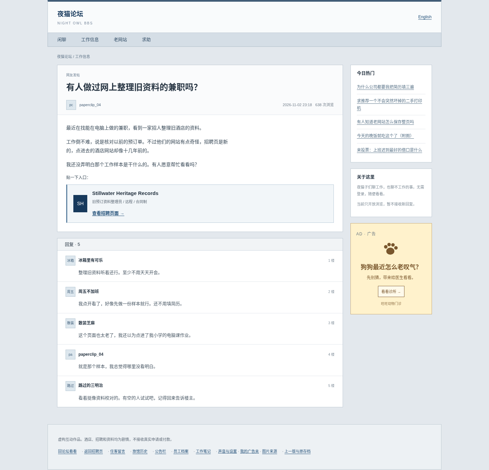
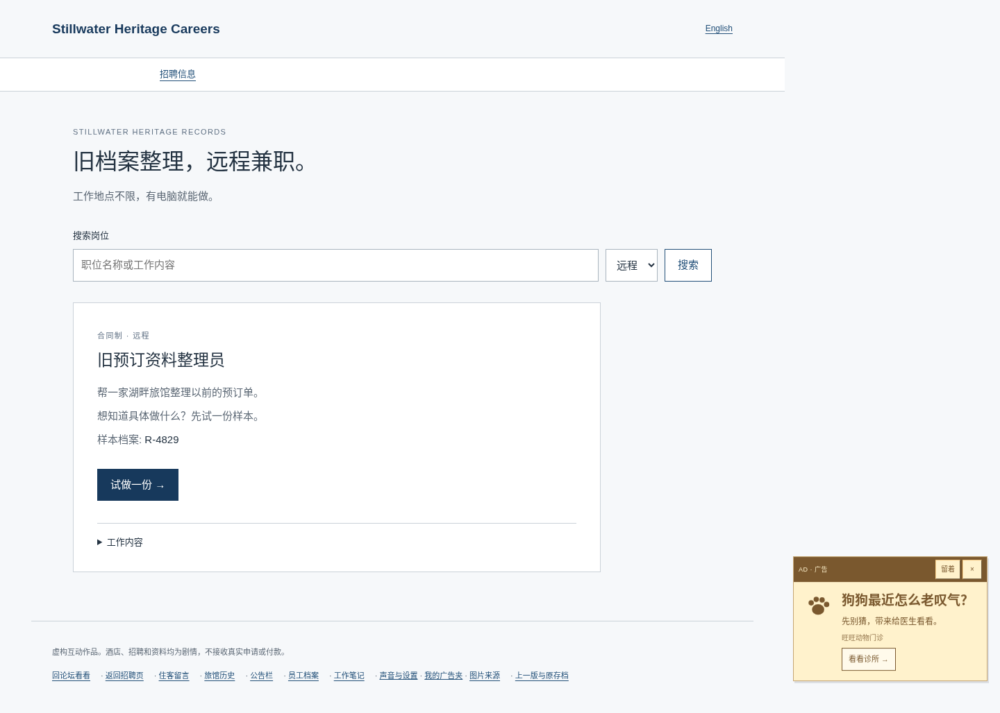

# Stillwater V2.1 交付说明

本次依据上传的《论坛文案广告 Codex 详细指令》增量实施，并采纳用户追加要求：**简化解谜文字，保留解谜规则。** 新增论坛和广告，不重建 V2 主线，不改 classic。

## 修改与新增文件

| 文件 | 内容 |
| --- | --- |
| `forum-data.js`、`forum.js`、`forum-style.css` | 中英文夜猫论坛、主帖与五条回复、五个普通话题、分区与招聘入口 |
| `ad-data.js`、`ad-system.js`、`ad-style.css` | 七家虚构小店、原创本地 SVG、限量调度、详情、广告夹及预留布局 |
| `case-feedback.js` | 独立的错误帮助展示层，按连续失败次数逐级提供方向 |
| `case-app.js` | 论坛默认入口、老存档续玩、语言和深链接兼容、文案与广告挂接 |
| `case-pages.js` | 酒店/留言/员工/草稿/结局的中文调整，移除过早解释，简化操作说明 |
| `case-data.js` | 只调整中文展示文字；事实、来源、时间、选项 ID 和正确性不变 |
| `case-state.js` | 只增加公开 `forum` 路由；hydrate、transition 和结局条件保持原样 |
| `case-comfort.js` | 设置说明简化，明确重开主线保留原存档与广告夹 |
| `index.html`、`index-zh.html`、`build.mjs`、`server.mjs`、package 文件 | 加载/打包新资源、4.1.0 缓存版本、测试命令 |
| `tests/v2-*`、`tests/server.test.mjs` | 新旧入口、双语通关、错误恢复、广告计时和布局检查 |
| README、文案审查表、本说明及截图 | 下载、存档、操作与交付记录 |

`classic.html`、`classic-zh.html`、旧运行脚本、样式、图片、音频与原存档 key 均未修改。

## 中文替换示例

完整审查清单和更多替换见 [V2.1 文案审查表](V2_1-COPY-AUDIT.zh-CN.md)。下面列出实际使用的示例。

| 原文 | 现在 |
| --- | --- |
| 让每一份旧档案都有据可查。 | 旧档案整理，远程兼职。 |
| 远程档案整理与复核岗位。 | 工作地点不限，有电脑就能做。 |
| 历史档案复核员 | 旧预订资料整理员 |
| 整理一家已停业湖畔酒店的历史预订资料。 | 帮一家湖畔旅馆整理以前的预订单。 |
| 查看样本资料 | 试做一份 |
| 岗位详情与公司介绍 | 工作内容 |
| 湖畔小住，舒适相伴。 | 来静水镇住一晚吧。 |
| 核对官方客房目录 | 对一下房间列表 |
| 原预订单分配的房号 | 预订单上写的房号 |
| 查看前台批注 | 看前台回复 |
| 来源记录复核 | 核对当晚记录 |
| 按原件时间排列当晚的记录，再判断这些资料能够证明什么。 | 用“上移”和“下移”按日期、时间从早到晚排列，再选择下面的核对结果。 |
| 关于“住客真实入住服务位”的结论 | 这些记录能确定住客住进了 317 吗？（房号取自原变量） |
| 核对时序与记录性质 | 提交核对结果 |
| 同一记录的两个版本 | 这份记录被改过 |
| 只标记两个原件之间实际发生改变的字段。原预订引用不变。 | 左边是原稿，右边是修改稿。逐行对照，只勾选内容不一样的行。 |
| 留存差异记录 | 保存对比 |
| 未提交的原备注 | Mara 没发出去的备注 |
| 记录处理意见 | 最后确认 |
| 选择能够被原件支持的三项证据，再决定记录应如何归档。 | 选三条能在之前的文件里找到依据的说法。核对通过后，再选择是否结案。 |
| 重新核对所选证据 | 返回修改 |
| 登记标注层对照（同一底图） | 照片上的登记文字 |

前台只简短确认收到钥匙套的问题，并给出当天楼层图；不再替玩家讲完整推理。Mara 的草稿用短句说明她查过什么、为什么没选“已完成”，不直接称呼玩家，也不提前叙述 2007 的改写。

## 玩家入口与广告行为

新玩家：论坛 → 招聘 → 试做样本 → 预订查询 → 原有调查路线。论坛不提供房号、员工姓名或停业答案。显式 hash、语言切换和有进度的 schema 2 存档不会被强行送回论坛。

广告只在公开页出现：首次随机 45–75 秒，后续 90–150 秒且需要一次导航；论坛起初至少 35 秒没有浮窗。同一标签页最多三张主动广告，不重复。输入、对话框、隐藏标签页、关键调查页暂停。关闭、留着、收起、手动重开分别处理；广告夹长期保存，计时和已显示记录只保留在 sessionStorage。读到 Mara 后，公开页固定广告和浮窗也停止。

手机浮窗最高 28vh，并压缩网页的可视区域，留出独立位置；桌面预留侧栏。不会把广告叠到提交按钮上。不抢输入焦点、不播放声音、不打开外部窗口。七家店铺只有本地虚构内容，不接受上传、预约、付款或真实申请。

## 实际界面截图

论坛桌面：

论坛手机（375px）：

广告浮窗与网页预留区域：

## 验收记录

- `npm run build`：成功，dist 包含全部新旧入口和资源。
- `npm test`：13 项全部通过（静态服务、主线状态、广告调度规则与内容检查）。
- `npm run test:e2e`：157 项全部通过，其中新版 27 项、classic 130 项。
- 完整流程：中英文均无预填存档，从论坛进入招聘、查询预订、对照目录、读留言、查平面图和维修、排序夜审、比较修订、阅读停业与草稿，最终到两个结局；刷新、回看与另一结局仍可用。
- 新版覆盖：论坛首次进入/有效深链接/旧 schema 2 存档/语言切换、所有普通帖子、前期不泄露答案、三级错误帮助、计时/输入/隐藏标签页暂停、单次 session 最多三广告、关闭/固定/收起/重开/移除/刷新、Esc 焦点返回、降低动态、主线重开保留广告夹、七家店铺、无外部请求和个人资料字段、受限存储下继续操作。
- 布局：375 / 768 / 1440 像素检查通过；沿用的 320 / 390 等双语检查也通过。手机广告最高 28vh，实测与网页可视区不重叠；桌面预留侧栏。
- 与基线 `66bf292` 的数据比较通过：所有事实、线索来源与依赖、时间、排序、修订正确标记、最终选项 ID/正确性/英文含义及图片署名完全相同。
- `case-state.js` 相比基线只有公开论坛路由一行新增。classic 源文件无变更。
- 初次检查中发现“输错预订号”的帮助链接指回查询页，已改为招聘样本；修正后定向检查通过，随后全量 157 项通过。当前没有未解决的失败。

自动化验证了可达性和状态恢复；尚未进行新玩家真人盲测，不把自动化用时当成实际游玩时长。原始阶段日志保存在本次执行环境的 `/tmp/v21-*.log`，不作为游戏资源发布。线上发布采用 HTTPS 文件和版本一致性校验，交互流程在本地浏览器验证。
