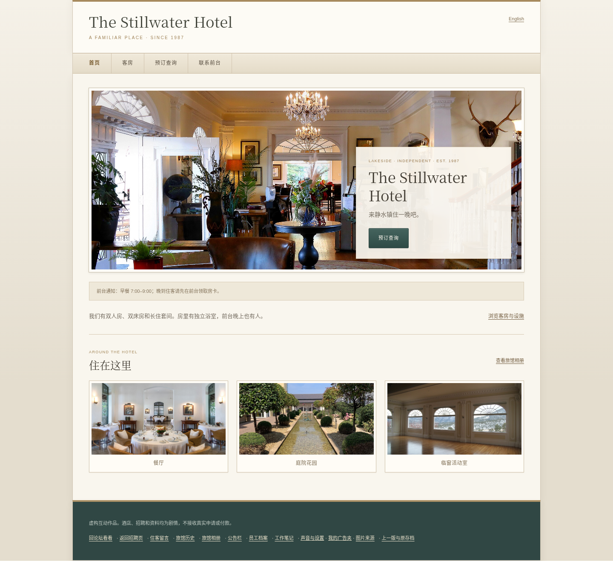
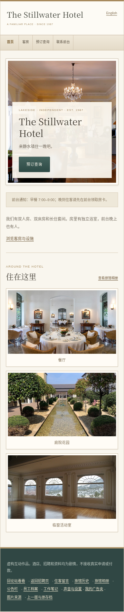
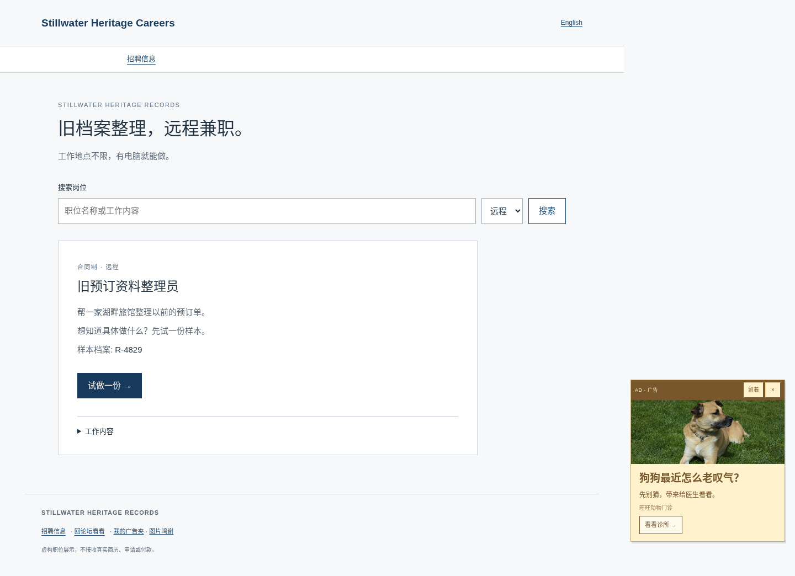
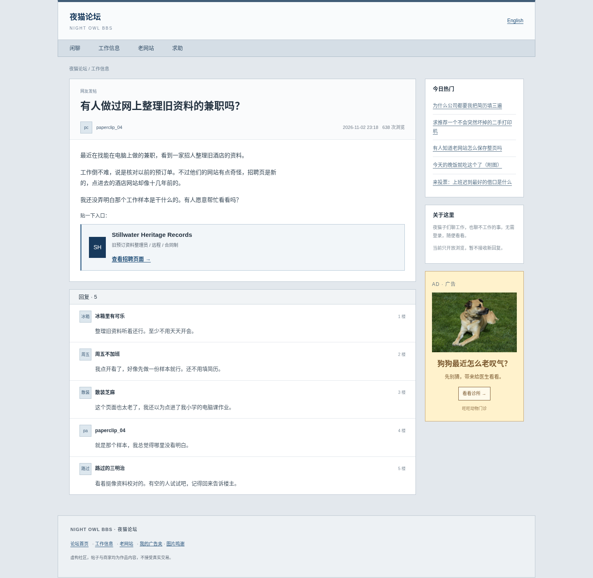

# 图片与酒店官网样式更新 · 4.2.0

根据本次要求，更换广告配图、丰富酒店照片、采用 2010 年代酒店官网样式，并把论坛/招聘页脚与酒店操作入口分开。主线故事、密码/选项、C1–C9、结局和原存档不变。

## 现成图片与来源

新增 15 张 Wikimedia Commons 的已有照片：9 张用于广告及猫咪作品页，6 张用于酒店。授权包括 CC0、CC BY、CC BY-SA；下载后的图片字节不作修改，页面用 CSS 适配版式。没有生成新的 logo 或图片。

- 广告：休息的小狗、红色影院座椅、键盘、唱片、打印设备、三张猫咪照片、蓝天白云。
- 酒店：建筑外观、前厅、临窗活动室、餐厅、庭院、咖啡与早餐。
- 新增图片约 3.1 MB，均打包到 `assets/web/`，游玩时不加载外站图片。
- 完整作者/来源/授权在 [照片授权表](../assets/WEB-PHOTOS.md)、`assets/web-photo-credits.json` 和网站图片鸣谢中。SHA-256 可核对实际文件。
- 原有五张酒店照片、旧版图片清单和署名不变。真实场所、人物和作者不参与或代言虚构剧情。

## 网站与入口

论坛页脚只有论坛首页、工作信息、老网站、广告夹、图片鸣谢；招聘页也有独立页脚。图片鸣谢在本页弹出，关闭后仍在原网站，不提前进入酒店。

酒店菜单、旅馆历史、工作笔记、员工档案、游戏设置和上一版入口只出现在酒店及其文件页面。没有因为存档已通关而重新把这些菜单塞回论坛。

酒店页面保留四个主要导航，增加独立的「旅馆相册」。采用米白纸色、Georgia/宋体标题、铜色细线、渐变导航和按钮、细边框照片及半透明主视觉文案，参考 2010 年代官网的常见做法。内部档案继续保留灰色报表，论坛的灰蓝样式继续保留。

相册显示 10 张照片。餐厅、庭院和活动室在首页下方展示；前台服务和旅馆历史使用对应环境照片，客房页保留原三种房型和设施说明。新增图片不承担解谜用途，没有加隐藏数字或随机异常。

广告保留关闭、固定、收起和详情操作；实拍配图替换了原来的绘制图标。手机广告最多 28vh，仍有独立预留区域，不叠在页面操作上。

## 截图

酒店桌面：

酒店手机：

实拍广告与招聘页独立页脚：

论坛与独立页脚：

## 验证

- `npm run build` 成功：新脚本、样式和全部图片均进入 dist，继续支持 GitHub Pages 的 `/123/` 子路径。
- `npm test`：16 项全部通过，包含原图片保持、15 张新图片逐文件 SHA-256、作者/授权完整性、广告与主线状态。
- `npm run test:e2e`：165 项全部通过，其中当前版 35 项、classic 130 项。
- 覆盖：论坛/招聘页脚不显示酒店操作、鸣谢弹窗不改变所在网站、双语完整通关、所有广告的照片与署名、10 张相册图片实际加载、广告固定/收起/关闭、旧存档、声音设置和经典版支线。
- 320、375、768、1440 像素无页面横向溢出；手机浮窗与网页可视区不重叠。
- `case-data.js` 与基线 `be64e73` 完全相同。主线事实、原图片条目、所有线索和正确选项均未改变；`case-state.js` 只增加公开相册路由。
- 原五张图片和经典版源文件均未修改。第一次定向布局检查的测试时钟安装过晚，导致广告定时器没有被测试时钟控制；调整测试启动顺序后四种宽度全部通过，随后完整 165 项回归通过。没有未解决的失败。
- 线上发布后比较公开脚本、样式与图片的 SHA-256，确认页面使用本次版本。
