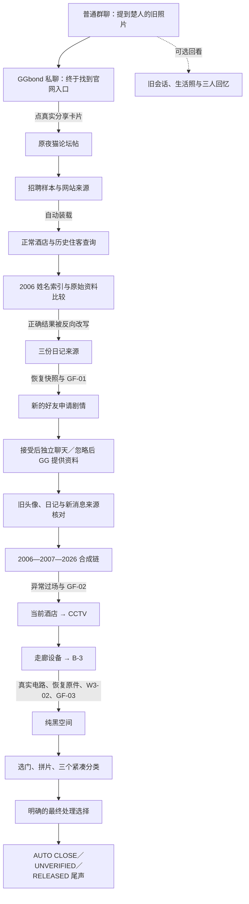

# Stillwater Hotel V1.2：仓库冲突审查与实施方案

状态：仅完成审查和方案，未修改游戏运行代码、聊天接口、Cloudflare 后端或线上版本。

审查基线为 `048d61a70544e06ef8553bb4239bfbfede628036`（发行版 4.17.0）。已只读确认 GitHub `main` 与本地 HEAD 相同。工作区原有的 `docs/NEXT-STORY-REVISION.zh-CN.md` 保留，未覆盖。

## 依据及优先级

已完整阅读 `Stillwater_Wang_Churen_Story_Bible_v1_2.md` 的 V1.2 正文。独立附件 `Stillwater_Wang_Churen_Character_Backstory_v1_2.md` 与总稿中对应人物部分逐字一致；附录与此前已读 V1.1 的唯一文本差异为概念参考图文件名。不会再把附录的“保留 C1–C9 必做流程”用于覆盖 V1.2 的瘦身要求。

执行顺序：用户本次要求 → 总稿前部 V1.2（尤其 B、F3、H、L、M、O）→ 不冲突的旧稿技术和视觉细节。用户已选定的现有 NULL 鬼脸继续保留。

本轮不是再给旧谜题增加一组人物题。新的前台目标始终是寻找朋友；旧酒店记录用来解释他的材料为什么被改写。

## 1. 事实冲突、缺口与保留边界

### 1.1 需要锁定的人物事实

| 项目 | V1.2 唯一基准 | 玩家何时知道 |
| --- | --- | --- |
| 姓名 | 王楚人；Wang Churen / Churen Wang 是正常姓名顺序变化 | 前几分钟 |
| 年龄 | 2002-04-19 生；2023 失踪时 21 岁；2006-10-17 时四岁 | 早期知道失踪时年龄；生日可选查看 |
| 成长与留学 | 苏州长大，2021 年赴芝加哥，2023 年秋大三 | 旧聊天、生活照片及课程资料逐步呈现 |
| 学校 | 架空 Northlake School of Design & Media，视觉传播与数字媒体方向 | 校园照及作业归档；学校不是阴谋机构 |
| 友情 | 与 GGbond、玩家有共同吃饭、拍照、测试网页的经历 | 前五分钟建立基本关系，不先读人物履历 |
| 性格 | 会纠错，也会承认不知道；喜欢旧照片、网页、相机；有日常缺点 | 正常聊天和生活记录，不能只在解题时出现 |
| 家庭 | 父王世航、母林秋仪、妹王又一，均为虚构；都有自己的生活 | 早期见到家庭存在，细节可选阅读 |
| 调查动机 | 学校项目与兴趣驱动，查看公开资料、公共空间 | 首份真日记和独立课程提交资料 |
| 地点 | 美国密歇根州西南部架空 Silverpine / 银松镇，旧湖区 | GGbond 私聊及到达照片 |
| 最后可靠消息 | 2023-10-17 18:12；不能写成 10 月 21 日 | 早期可查旧会话 |
| 最后可靠文件 | 2023-10-17 18:26 相机文件；本地便签只能在后期恢复 | B-3／原始文件恢复之后 |
| 下落 | 未知；不确认被害、绑架、故意失联或复活 | 贯穿所有结局 |

历史场景时间固定保存，并明确是故事发生地时间；不因玩家切换系统时区而改变最后联系日期。2026 游戏当前消息与 2021–2023 历史消息分开标注。

### 1.2 与仓库的具体冲突

| 等级 | 当前代码或资料 | 与 V1.2 的冲突 | 处理 |
| --- | --- | --- | --- |
| 必改 | `chat-story.js` 旧会话统一从 2023-10-21 18:10 起算；`case-story-data.js` 的旧聊、笔记、论坛、现场照片也标 10/21 | 可靠失联日期是 10/17；现状等于让他在失联后继续正常调查 | 按 J2 重建分日期历史记录；真日记按 I1–I6 逐份建来源，不能只批量替换日期 |
| 必改 | 新资料中地点使用 Silversong | 新基准是 Silverpine，且须说明中国留学生为何在美国调查 | 统一地名、学校、出行与课程动机；旧案中的真实保留事实不受影响 |
| 必改 | 原群聊先发布兼职卡片，之后 `shared` 才触发 GG 私聊；补充失联背景还依赖已查看旧会话或索引 | 主线起点应为 GG 私聊，玩家要先认识朋友，不能搜到名字后才知道为什么找他 | 保留群聊与自由 AI，替换固定剧情顺序；私聊先分享实际论坛卡片，群聊不再抢先开启另一条入口 |
| 必改 | 旧账号八条消息几乎只讲地图和酒店；头像分别是渡口、通道 | 缺少人物脸、大学生活和共同经历 | 增加 2021–2023 正常历史、可回看的生活照片；头像、家庭和校园素材按统一人物制作 |
| 必改 | 原日记 A 是 10/21“第四次”旧湖区记录；B/C 仍用旧稿短模板 | 与新的可信时间线、生活细节和混合文本来源不一致 | 用 I1–I8 替换新流内容；旧版脚本来源留在兼容资料中，不伪装成新的原始日记 |
| 必改 | 日记核对必须先 `restored=true`，旧论坛来源也依赖恢复 | V1.2 是日记来源判断完成后恢复 404、播放 GF-01、得到照片并进入申请 | 取消先恢复才可判断的硬依赖；提前提供学校归档与已收到旧消息作为独立来源 |
| 必改 | 两套核对台各有必做结果，`StoryModel.ready()` 还要求叠片和签字预览 | 寻找王楚人仍附着在另一套完整旧案流程上 | 新流只保留四个核心推理点；叠片作为观察工具，取消独立签署意向关卡 |
| 必改 | `case-story.js:controls()` 成功只保存、同步、重绘；原核对提交也回到原面板 | 没有成功后自动进入下一幕 | 增加统一的剧情转场适配，关键验证事件返回明确下一站；普通浏览不跳走 |
| 必改 | `completed.finalEvidence`、C1–C9、旧题结果仍控制监控、录像、W3-02、黑空间和结局 | 隐藏旧页面后仍会留下不可满足的后台门槛 | 新流以新条件进入；旧字段和旧档通路保留，不能用全量自动勾 C1–C9 糊过去 |
| 必改 | 既做签字预览，终章又选处理，返回 B-3 后还可能要锁定和再次按退出 | 玩家分不清哪次决定真正生效，也不知道何时结束 | 取消主线预签；最终选择明确后果。RELEASED 选择本身明确执行锁原件并结束，不另找退出按钮 |
| 必改 | 黑终章三分类后另有 `story.findings.footage` 第四道必做题 | 重复证明同类结论 | 跨年代来源融入 GUEST 核对；保留三类实际验证，移除重复第四题门槛 |
| 缺口 | 没有 18:26 最后门照与晚恢复便签的独立来源阶段 | 当前普通现场照不能充当最后可靠文件 | 增加后期原始备份来源，单独保存拍摄、收到、恢复时间；不提前泄露 |
| 缺口 | 结局主要恢复渡口场景和目录信息 | 缺少 V1.2 的普通家庭／三人合照与语音文字稿落点，旧“12 号储物柜”也不是新稿的“资料柜第 12 号文件夹” | 重写尾声，以照片、原留言和可对照的文件目录收束；不宣布已经救回朋友，不要求现实寻柜 |
| 技术缺口 | 前端 `wcr_new` 发送路径为本地脚本；当前协议和仓库 Worker 白名单只有七位日常联系人 | 总稿 L5 提到新号可正常 AI 闲聊，不能把当前本地功能称为已接通 AI | 与原七人隔离说明，见第 4 节；不伪装角色调用接口 |
| 已符合，保留 | `case-data.js` 中 E. Vale / R-4829 / 318、317 服务暂存、03:17 移交、Mara E-014 等 | 无需推翻这些事实 | 改它们在新路线里的用途及出现顺序，不改成 2006 的王楚人事件 |

### 1.3 稿内需要统一的细节

- E1 把认识 GG 写成校园投影文件，G1 的具体场景则是打印室导出失败。建议采用 G1 的完整打印室场景，后续短介绍也用同一表述；不另编两个“第一次认识”。
- “他当时只有四岁”是怀疑的起点，不能单凭年龄证明他绝不可能去过某地。最终判断仍依赖原预订单、区域用途、旧头像来源和后来的修订。
- P2 的轻微错帧不直接露完整鬼脸；首次半脸放在日记完成后的 404 恢复，第二次放在合成链验证后的反向改写，第三次在 B-3。由此协调 L3 的局部异常与 K4 的三次露脸顺序。
- 2023 日记提到的“招聘页跳转”不自动等同于 2026 的当前招聘项目，不能反向给王楚人 2023 的材料写入后来才出现的事实。
- 旧稿字面 `wcr-old`、`wcr-new` 与代码 `wcr_old`、`wcr_new` 仅为内部别名。保留下划线 ID 兼容存档，不把 ID 拼写变化编成异常。
- J8 中“玩家：你说的放回去是什么意思”等句子作为可回应的分支样例；不让脚本替当前玩家自动发送新话。明确标注为历史的玩家旧消息另行处理。
- 王楚人的家庭群是他的家庭资料，不是玩家现有“妈妈／爸爸”联系人；不会替换或混用两家的记忆。

## 2. 页面保留、合并、可选与重写清单

“移出主线”不等于删除文件或证据 ID。现存资料可保留回看；新玩家不再需要分别通过所有旧表单。

| 页面／模块 | 决定 | 新流程中的作用 |
| --- | --- | --- |
| 微信 `chat` 外壳、联系人、AI 设置 | 保留 | 只挂接版本化剧情与素材，不另做聊天软件 |
| 旧王楚人会话、GG 私聊、新号申请 | 重写内容，复用已有框架 | 旧聊跨 2021–2023；GG 私聊是入口；新号独立保存且可忽略 |
| `forum` | 保留普通帖和社区浏览，调整主帖入口 | 仍到原帖子；清楚指向网站来源／招聘样本，不增加另一套找入口谜题 |
| `careers` | 保留公司与岗位，精简样本操作 | 登记样本后自动进入正常酒店，结束“先当档案审核员”的前置任务 |
| `hotel` | 保留旧官网风格，改主行动 | 正常房型、早餐和前台内容仍在，历史住客查询成为明确入口 |
| `rooms`、`guestbook`、`gallery`、`history`、`contact`、`notices` | 保留自由浏览 | 必要原件可从当前谜题直接打开；不再强迫绕路找编号 |
| `reservations`、`floor-plan` | 保留原件，嵌入第一推理点 | 索引固定作比较对象，玩家选原预订单、客房目录、区域登记三份来源 |
| `evidence-desk` + `source-review` | 合并为一个玩家入口 | 同一处管理原件与当前判断，不再维护两套并行必做任务；旧链接仍恢复到对应资料 |
| `notes` | 保留并精简 | 一项当前目标、明确下一站、已保留原件；不把大量未开放项目展示成任务清单 |
| `guest-index` | 重写 | 支持三种姓名写法；显示的 2006 入住与资料生成／修订年份分开 |
| `wcr-sources` | 改为人物和来源资料目录 | 日记、学校、家庭、旧照片有可选全文入口，不另加必做审批 |
| `history-cache` | 保留玩法，重排时序 | 日记完成后恢复；来源版本仍可回看，GF-01 不充当判题条件 |
| `source-trace` | 保留来源判断，重写资料和界面 | 比较旧头像、真日记、当前新号引用；没有接受申请也能通过 |
| `photo-overlay` | 保留观察工具，移出独立强制过关链 | 根据当时问题调用；不与 B-3 再考一次同样的门牌结论 |
| `maintenance`、`night-audit` | 原档可选，取消独立强制排序／再分类 | 02:40、02:50、03:17、03:24 仍可查；新流不先通过整套夜审题 |
| `staff`、`revisions`、`closure`、`mara` | 必要原件保留，合并呈现 | 四个必要旧案事实进入一处合成链推理，完整原档可展开 |
| `rewrite-review` | 重写为唯一合成链谜题 | 说明旧错误如何被再利用，去掉六段关系各选两次的繁复操作 |
| `review` 与签字预览 | 合并／移出主线 | 必要核对完成自动转场，不再另签一次无实际结局效力的“意向” |
| `mirror` | 保留异常阶段，改成明确剧情场景 | 一次呈现目录／留言改写差异，之后自动到 CCTV；取消强制分别回访两页的流程门槛 |
| `cameras`、`service-passage` | 保留操作，强化完成后的转场 | 三机位与空间观察仍真实验证；实际维修入口打开后进入 B-3 |
| `terminal` / B-3 | 保留物理机制，改动机和接出 | 六接头、隔离、MANUAL、保存、03:17、原件保护都保留 |
| W3-02 / `hotel-promo` | 保留三版本和来源核验 | 原始宣传照始终可补看；关闭广告或漏点广告不挡主线 |
| `void` | 保留选门、观察和拼片；精简文本与分类 | 三类紧凑实际核对，来源边界整合进去；随后直接进入最终决定 |
| `ending` | 保留三个 ID，重写人物尾声 | 明确完成、GAME OVER；原件、家庭和朋友照片回收人物关系 |
| `null-archive`、`credits` | 可选保留 | 错帧与来源可回看，不成为新必做清单 |
| 原广告及广告开关 | 保留 | 维持普通互联网感，不再借广告追加一轮无关主线验证 |

### 四个核心推理点

1. **原始记录是谁、317 原来做什么。** 将原空间题与姓名题合成一次有实际比较的判断。
2. **哪些文字确实出自朋友。** 用课程提交与已收到旧资料交叉支持生活原句，识别被拼入的系统句；去掉原九项连续判断。
3. **新账号拿出的材料是不是独立来源。** 重点是旧图复用、原句出处与网站字段的传播方向，不问“信好人还是信坏人”。
4. **旧错误怎样变成了现在的入住记录。** 2006 未核实 → 2007 错误修订 → 2026 合成姓名；这是唯一需要总结旧案的大谜题。

这四项之后是监控、走廊、真实接线与空间玩法；终章三类针对空间、身份年代、人员授权分别检查，不再追加第四轮同义题。

### 玩家可见路径

## 3. 六个最重要的自动转场

以下是拟实施行为，不是当前版本已具备的功能。

| ID | 真正完成的条件 | 演出与下一站 | 必须避免的旧问题 |
| --- | --- | --- | --- |
| T1 样本 → 酒店 | 样本登记及旧站来源关联成功 | 自动装载 `hotel`，以正常首页和明确住客查询入口接住玩家 | 仍跳到编号查询，先强迫完成 C1–C9 |
| T2 原件比较 → 日记 | 当前姓名索引与三份原件的关键判断正确 | 保存冲突 → 显示副本被改写、GG 消息入队 → 日记场景 | 要找页底“下一附件”，或先完成独立旧空间题才给新题 |
| T3 日记 → 申请 | 真句／补写句来源判断正确 | 恢复 404 快照 → GF-01 或静态替代 → 进入微信的“新的朋友”剧情面板 | 先恢复才能答题；还未接受就强开新号私聊；用鬼脸播放成功当通关条件 |
| T4 账号来源 → 修订 | 对头像复用和引用来源作出有原件支持的判断 | 保存结果与双向建议 → 自动回酒店修订来源页 | 必须接受申请或准确输入某句口令才推进 |
| T5 合成链 → CCTV | 四个旧案事实与跨年代错误关联核对完成 | 显示 TEMP-015 → 当前酒店异常场景／GF-02 → CCTV 主场景 | 独立预签、汇总再提交，再手动重看两页才能到监控 |
| T6 B-3 → 纯黑 | 通道设备已完成；实际电路有效、隔离、MANUAL、已保存、原始帧和 W3-02 核验齐备 | 保存可读来源 → GF-03 或静态替代 → 明确恢复画面过场 → 纯黑空间 | 录像刚亮便跳走，漏掉隔离／保存；或要求黑空间之前先锁原件形成循环 |

另三处必须明确接续：论坛卡片直达原帖；监控／走廊的真实操作完成后进入 B-3；黑空间三类核对完成后进入最终决定。它们不是可省略的小字入口。

### 实施方式与恢复

- 新增薄的剧情转场层（可独立为 `case-story-flow.js`），复用 `case-app.js` 路由及 Messenger Bridge。状态验证返回 `completionEvent` 和下一场景；视图不靠 DOM 猜下一步。
- 顺序是验证成功、保存原件和结果、安排演出、进入下一站。只有从未完成到已完成的提交触发转场。查看、比较、重看和错误提交不触发。
- 普通成功反馈可约 0.8–1.5 秒；长日记、重要聊天不会被计时跳过，而是进入可慢慢阅读的新场景。原文可随时回看。
- 待转场 ID、目标和已消费状态持久化。刷新、切换语言、后台恢复时最多续接一次；如果目标不能打开，显示明确的“恢复到某场景”，不沉默停住。
- 剧情消息在稳定点投递，不在旋转接头或文本输入中强切微信。进入好友申请使用现有微信框架的剧情小面板，不重做微信主页。
- 最终选择仍由玩家作出。RELEASED 控件明确写出“锁定原件并结束调查”，实际核验并执行锁定和结局保存；保留锁定条件，但不再让玩家回头寻找第二个结束按钮。

## 4. 微信 AI 的保护边界与剧情接口

### 不重写的部分

`chat-view.js` 的桌面／手机版外壳、`chat-transport.js` 的同意与会话机制、现有 API 地址、Cloudflare 请求和用量控制、七位日常联系人、独立上下文、提示音、未读、草稿、滚动、Messenger Bridge 的原页缓存和返回入口全部复用。不会改 Worker Secret，不要求提供密钥。

允许的最小接入是人物资料、作者写好的消息／附件、好友申请面板和完成事件。玩家真实输入立即保留在原会话；重要剧情不让 AI 决定，也不要求输入精准关键词。

### 拟新增的固定事件接口

| 事件（新命名空间示例） | 作用与触发 |
| --- | --- |
| `v12.friend_intro` | 正常群聊提到楚人，提供旧会话和已完成生活照入口 |
| `v12.gg_discovery` | 在论坛入口前投递 J3 私聊和真实论坛卡片；唯一主线开端 |
| `v12.index_seen` | 玩家实际看到姓名索引后投递 J4；不提前知道后面资料 |
| `v12.original_check_passed` | 保存结果与改写差异；GG 的两张截图是可回看的来源，不只是通知 |
| `v12.diary_sources_verified` | 驱动快照恢复、GF-01 与好友申请场景 |
| `v12.friend_request` / `request_decision` | 接受、暂时忽略、询问 GG 各有恢复路径；不假装已接受 |
| `v12.new_account_round_1/2/3` | 按已发现资料逐轮投递 J6，不在接受时一次发完未来台词 |
| `v12.account_sources_verified` | 完成头像／文本来源核对，进入合成链 |
| `v12.merge_verified` | TEMP-015、异常阶段、GF-02 与 CCTV 转场 |
| `v12.b3_original_restored` | 真实设备成功后投递 J9、GF-03 和未归档来源 |
| `v12.ending.<id>` | 正确结局提交后投递对应消息和相册，不反过来授予结局 |

事件使用已有的“案件队列 → 微信保存 → 回执”路径，加入版本化消息键与逐条投递进度。保留旧键的解析，不能把已保存的旧台词键直接换成另一段人生经历，也不能覆盖玩家自由聊天。

### 当前新号 AI 的实际缺口

仓库前端 `wcr_new` 当前直接走本地脚本，`chat-protocol.js` 与仓库 Worker 只允许七位日常联系人；仅在前端加头像不会让新号变成 AI。

若落实总稿 L5 的新号自由 AI，需要在原传输和后端结构上增量配置新角色、独立 Prompt 与白名单，并部署到既有 Worker；不能冒充 GG 调用。关键事实仍用本地脚本，普通 AI 不能解谜、创造链接或确认新号身份。现有输出防剧透规则不能简单全局关闭。

此项单列为后端增量部署依赖，第一阶段不改现有在线服务，未部署时如实标示本地回复，不算“AI 已完成”。原七位角色尤其父母、普通朋友，不会自动获得王楚人的私人资料或酒店秘密。

## 5. 人物资产与玩家可见层级

详细统一素材及状态见 [ASSET-PLAN.zh-CN.md](ASSET-PLAN.zh-CN.md)。本次没有生成新照片。V1.2 建议的 16 项当前均未制作成正式资产；现有两张空场景图不能充当人物照片。

| 内容 | 早期必要内容 | 可选完整内容／幕后事实 |
| --- | --- | --- |
| 友情 | 楚人是与玩家、GG 共同生活过的朋友；至少一张真实完成的生活照和一段旧聊 | 吃面、地图拿反、网页测试等完整回忆，不把每件事变密码 |
| 留学与动机 | 芝加哥读设计，为课题查 Silverpine | 学校课程代码、兼职与全学期时间表 |
| 家庭 | 有父母和妹妹，外套与土豆狗是日常 | 父母全名、职业、完整家庭年表不一次塞进开场 |
| 失联 | 2023-10-17 最后可靠消息及下落未知 | 18:26 文件及便签必须后期恢复；不能当早期 GG 收到的消息 |
| 酒店旧案 | 四个必要事实 | C1–C9 原档、完整制度文本与技术编号可选展开 |
| 新账号 | 同名新 ID，照片和记忆有可追查来源 | 不把某句答对当本人认证，不自动宣布它是鬼 |
| NULL | 统一原脸、与来源变化相关的错帧 | 四态及触发状态只在开发数据中，不盖过朋友的人物故事 |

## 6. 前两个开发阶段与验收

### 第一阶段：人物与开场的一条可验收路径

范围：人物规范、旧会话、GG 私聊、已有微信的独立叙事适配、七项优先素材及回看。不拆整套旧关卡，不修改电路和结局。

可验收成果：

1. 统一生日、年龄、美国学校、Silverpine、最后联系日期和已知／未知边界；中文与英文同源，未进行人工英语审核时不标为已人工核对。
2. 先完成旧头像母版，再制作其余六项优先素材并做同脸、年龄、衣着和来源核对。没有完成的资产在开发清单标缺，正常游戏不伪装成已存在的照片。
3. 通过现有群聊、旧头像／生活照、跨日期旧会话和 GG 私聊，前五分钟让玩家理解朋友关系及寻找动机；不强迫读完人物传记。
4. GG 私聊的真实卡片直达原帖；普通私聊和 AI 仍可继续。消息只触发一次，未读、草稿、滚动、输入及浏览器返回不丢。
5. 先接通叙事层的幂等事件／恢复接口并验证，不立即启用尚未测试的全线自动跳转。已接受新号不能在刷新后误变成旧号。
6. 至少核对旧存档、中文／英文、375px／桌面、长输入、连续发送、切房间及断线备用。新号 AI 若未部署，明确记录为未完成，不用模拟结果冒充。

第一阶段验收通过后才继续第二阶段；这不是先改完全部页面再集中排错。

### 第二阶段：主线瘦身与自动推进，接回原后半段

范围：四个核心推理点、六个主要转场、必要原件访问、三类终章整合和旧档兼容。

可验收成果：

1. 新玩家不需要先做完 C1–C9 的旧审核、四字段机械标记、九项日记判断、六段双选择和额外预签；仍需实际比较来源、得到有依据的结果。
2. T1–T6 及监控／走廊、三分类后的接续均有明确目标。测试不能靠手动改 hash、测试辅助函数 `navigate()` 或点击另一个“继续”才通过。
3. 正确答案但缺少实际来源、先后顺序颠倒、忽略申请、只看当前修复图等情况有可理解反馈；不能用 AI 或观看时长直接判题。
4. 新流移除旧门槛的同时保留原证据 ID；旧早期、B-3、黑空间和已结束存档可恢复。新字段缺失或损坏不清空旧进度。
5. B-3 六接头、90° 旋转、隔离、MANUAL、SAVE、帧恢复和 W3-02 确认真正完成才进入黑空间。原件锁定在最终明确选择时执行，不能前置成循环门槛。
6. 三种结局均可达；保护线路不自动替玩家选择 RELEASED。尾声中使用的家庭／合照素材必须已完成，不能拿“待制作”当交付。
7. 保留三个来源相关主要 NULL 演出、静态替代、静音和减少动态效果；惊吓失败不影响资料与下一场景。
8. 从未注入阶段状态的新档完整操作到三种结局，并另测旧档、广告关闭、手机、键盘、刷新及中英切换。自动转场中刷新必须只续接一次。
9. 若新号自由 AI 纳入本阶段，须单独验证既有 Worker 上的角色增量部署、同意机制、独立记忆和不可越权改剧情；未部署或未取得真实回复时，明确列为未验证，不把本地脚本或原七人的调用成功当作新号验收。

## 工程落点与存档迁移约束

- 复用 `case-story-data/model/pages.js`、`case-story.js`、原图、旧原件和现有路由；需要时只拆出小的转场模块，避免一口气重写四十页。
- 外层继续 `stillwater-case:v2` / schema 2。叙事子状态可增至 schema 2，并区分 V1.2 与兼容旧路线；原 C1–C9、旧题结果、夜班和结局字段不删除。
- 新路线的入口条件单独计算：四个必要推理点与真实设备状态，不能伪造旧证据全收齐。同步检查 `canOpen`、`recovery`、`hydrate`、`night-*`、`void`、`desk-footage`、W3-02 和 `ending` 的共同门槛。
- 微信继续 `stillwater-chat:v1`。新旧作者脚本键分别保留，保存的玩家文字不改；申请、事件进度和版本别名按默认值迁移。
- 文案三级：任务说明讲清楚问题、资料、动作；原件允许完整篇幅；完整人物圣经不直接做成必读页面。
- 两份语言入口及 `site-files.mjs` 只在实际引入新运行模块时同步更新；审查阶段不改版本号、清存档或发布。

## 本轮已做／尚未做

已做：全文阅读与版本比对、GitHub 基线确认、源码依赖审查、旧测试阅读、只读模型和资源盘点；产出本方案、素材清单及 `BASELINE.json`。

未做：未实施 V1.2、未制作新人物照片、未改 AI／Worker、未重跑或声称通过新的 V1.2 功能验收、未部署网站。本轮的模型与文件检查不等同于下一阶段完成。
